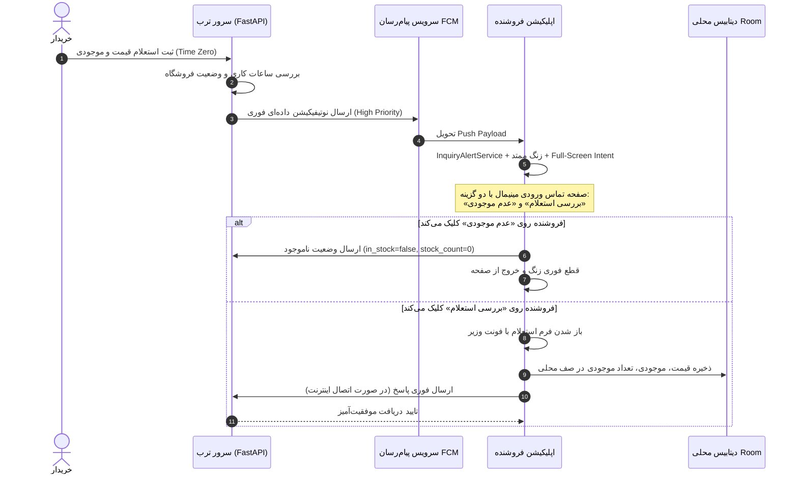

# مستندات جامع وب‌سرویس و معماری پلتفرم استعلام فروشندگان ترب (Torob Seller Platform)

این سند مرجع فنی کامل کلیه سرویس‌ها، مدل‌های داده، فرآیندهای احراز هویت، چرخه عمر استعلام‌ها، سناریوهای وضعیت فروشگاه و پروتکل همگام‌سازی آفلاین سامانه فروشندگان ترب است.

---

## ۱. نمای کلی سیستم و معماری (System Architecture)

سیستم استعلام فوری ترب شامل اجزای زیر است:
- **بک‌اند (FastAPI Backend)**: پیاده‌سازی شده با پایتون ۳.۱۲ و دیتابیس SQLite با پشتیبانی از صف بندی، اعتبارسنجی ساعات کاری، سرویس ارسال اعلان، و زمان‌بندی بررسی وضعیت (Inquiry Scheduler).
- **اپلیکیشن اندروید فروشنده (Seller Android App)**: پیاده‌سازی شده با Jetpack Compose و معماری تک‌فعالیتی (Single Activity) + کامپوننت تماس تمام‌صفحه (`IncomingInquiryActivity`).
- **پایگاه داده محلی کلاینت (Room Database)**: کش محلی استعلام‌ها و صف همگام‌سازی آفلاین با قابلیت تضمین تحویل نامحدود (Infinite Idempotent Queue).
- **پروتکل اعلام آنی (Time-Zero Instant Alert Protocol)**: راه‌اندازی زنگ ورودی با Full-Screen Intent اختصاصی در لحظه صفر ثبت استعلام خریدار.



---

## ۲. احراز هویت فروشندگان (Authentication)

احراز هویت فروشندگان بر پایه شماره موبایل و کد یکبار مصرف (OTP) با توکن JWT به صورت Bearer Token انجام می‌پذیرد.

### ۲.۱. درخواست ارسال کد تایید (Request OTP)
- **متد و آدرس**: `POST /api/seller/auth/request-otp`
- **سطح دسترسی**: عمومی (Public)

#### بدنه درخواست (Request Body)
```json
{
  "phone_number": "09123456789"
}
```

#### پاسخ موفق (200 OK)
```json
{
  "success": true,
  "message": "کد یکبار مصرف ارسال شد",
  "demo_otp": "12345"
}
```

### ۲.۲. اعتبارسنجی کد و دریافت توکن (Verify OTP)
- **متد و آدرس**: `POST /api/seller/auth/verify-otp`
- **سطح دسترسی**: عمومی (Public)

#### بدنه درخواست (Request Body)
```json
{
  "phone_number": "09123456789",
  "otp_code": "12345"
}
```

#### پاسخ موفق (200 OK)
```json
{
  "access_token": "eyJhbGciOiJIUzI1NiIsInR5cCI6IkpXVCJ9...",
  "token_type": "bearer",
  "seller": {
    "seller_id": "seller_test_001",
    "phone_number": "09123456789",
    "shop_id": "shop_51d0c1a6edf81ba759726bab",
    "full_name": "علی رضایی",
    "is_active": true
  }
}
```

### ۲.۳. دریافت اطلاعات فروشنده جاری (Get Current Profile)
- **متد و آدرس**: `GET /api/seller/auth/me`
- **سطح دسترسی**: نیازمند هدر `Authorization: Bearer <token>`

---

## ۳. وضعیت‌های عملیاتی و ساعات کاری فروشگاه (Shop Status & Working Hours)

فروشگاه در ۳ سناریوی مجزا می‌تواند فعالیت کند:

| سناریو | مقدار `is_open` | مقدار `accept_inquiries` | توضیحات عملکردی |
| :--- | :---: | :---: | :--- |
| **۱. فعال و پشتیبانی در دسترس** | `true` | `true` | فروشگاه باز است و استعلام‌های فوری خریداران دریافت شده و زنگ تماس نواخته می‌شود. |
| **۲. فعال اما پشتیبانی غیرفعال** | `true` | `false` | فروشگاه در ترب دایر است اما استعلام فوری دریافت نمی‌شود (مناسب زمان شلوغی حضوری). |
| **۳. غیرفعال و بسته** | `false` | `false` | فروشگاه کاملاً بسته است و هیچ استعلامی هدایت نخواهد شد. |

> [!IMPORTANT]
> **قانون قطعی ساعات کاری**: در خارج از ساعات کاری تعیین‌شده فروشگاه، سرور به هیچ عنوان مقدار `is_open=true` را بازنمی‌گرداند و درخواست‌های فعال‌سازی با خطای HTTP 400 رد می‌شوند.

### ۳.۱. دریافت تنظیمات فروشگاه (Get Shop Profile)
- **متد و آدرس**: `GET /api/seller/shop`
- **پاسخ موفق (200 OK)**:
```json
{
  "shop_id": "shop_51d0c1a6edf81ba759726bab",
  "shop_name": "موبایل تخت جمشید",
  "address": "خیابان جمهوری، پاساژ خانه موبایل، پلاک ۴۱۲",
  "phone": "۰۲۱۷۶۵۵۷۶۲۴",
  "is_open": true,
  "open_time": "09:30",
  "close_time": "21:30",
  "accept_inquiries": true,
  "holiday_mode": false,
  "manual_is_open": true,
  "is_within_working_hours": true,
  "status_message": "فروشگاه باز است"
}
```

### ۳.۲. به‌روزرسانی تنظیمات یا تغییر سناریوی فروشگاه (Update Shop Settings)
- **متد و آدرس**: `PUT /api/seller/shop`
- **بدنه درخواست (Request Body)**:
```json
{
  "is_open": true,
  "accept_inquiries": true,
  "open_time": "09:30",
  "close_time": "21:30",
  "holiday_mode": false
}
```

### ۳.۳. کلید سوئیچ سریع باز/بسته (Toggle Shop Status)
- **متد و آدرس**: `POST /api/seller/shop/toggle-status`

---

## ۴. استعلام‌ها و پاسخگویی (Inquiries & Stock Reporting)

### ۴.۱. لیست استعلام‌ها (List Inquiries)
- **متد و آدرس**: `GET /api/seller/inquiries`
- **پارامترهای اختیاری Query**: `status=ACTIVE` یا `status=ANSWERED` یا `status=EXPIRED`

#### پاسخ نمونه (200 OK)
```json
[
  {
    "inquiry_id": "inq_786524",
    "tracking_code": "TRB-98721",
    "shop_id": "shop_51d0c1a6edf81ba759726bab",
    "product_id": "prod_iphone15pro",
    "product_title": "گوشی موبایل اپل مدل iPhone 15 Pro ظرفیت 256 گیگابایت",
    "product_image_url": "https://torob.com/mock/iphone15.jpg",
    "category_name": "موبایل و تبلت",
    "recorded_price_toman": 68500000,
    "customer_name": "خریدار ترب",
    "customer_phone": "0912***4567",
    "inquiry_type": "price_and_stock",
    "user_note": "سلام، رنگ خاکستری تیتانیوم موجود دارید؟",
    "status": "ACTIVE",
    "created_at": "2026-10-23 06:15:00",
    "expires_at": "2026-10-23 06:25:00",
    "remaining_seconds": 540
  }
]
```

### ۴.۲. ثبت پاسخ استعلام به همراه تعداد موجودی (Respond to Inquiry)
- **متد و آدرس**: `POST /api/seller/inquiries/{inquiry_id}/respond`

#### بدنه درخواست (Request Body)
```json
{
  "client_response_id": "c1f7a0b3-469b-4e89-bcf4-6503c1ef7e6e",
  "offered_price_toman": 68200000,
  "is_in_stock": true,
  "stock_count": 3,
  "notes": "رنگ خاکستری تیتانیوم با ۱۸ ماه گارانتی اصلی شرکتی",
  "submitted_at": "2026-10-23 06:17:30"
}
```

#### فیلدهای کلیدی پاسخ‌دهی
- `client_response_id`: شناسه یکتای UUID4 سمت گوشی جهت Idempotency و ممانعت از تکرار درخواست (Double Action Prevention).
- `offered_price_toman`: قیمت پیشنهادی فروشنده به تومان.
- `is_in_stock`: پرچم موجودی (`true` یا `false`).
- `stock_count`: **تعداد موجودی اعلام‌شده توسط فروشنده**. در صورت عدم موجودی صفر و در صورت موجود بودن حداقل ۱.
- `notes`: توضیحات فروشنده برای خریدار.

#### پاسخ موفق (200 OK)
```json
{
  "response_id": "resp_a89bc321fe",
  "client_response_id": "c1f7a0b3-469b-4e89-bcf4-6503c1ef7e6e",
  "inquiry_id": "inq_786524",
  "offered_price_toman": 68200000,
  "is_in_stock": true,
  "stock_count": 3,
  "notes": "رنگ خاکستری تیتانیوم با ۱۸ ماه گارانتی اصلی شرکتی",
  "submitted_at": "2026-10-23 06:17:30",
  "received_at": "2026-10-23 06:17:31",
  "is_duplicate": false
}
```

---

## ۵. صف و همگام‌سازی آفلاین (Offline Queue & Batch Sync)

زمانی که ارتباط اینترنت گوشی فروشنده قطع باشد:
1. پاسخ بلافاصله در جدول `sync_queue` دیتابیس Room با وضعیت `SAVED_ON_PHONE` درج می‌گردد.
2. استعلام در رابط کاربری بلافاصله به وضعیت `ANSWERED` تبدیل شده و نشان «ذخیره در گوشی» نمایش داده می‌شود.
3. در زمان اتصال مجدد، عملیات همگام‌سازی دسته‌ای (`Batch Sync`) فراخوانی می‌شود.

### ۵.۱. همگام‌سازی دسته‌ای (Batch Sync Responses)
- **متد و آدرس**: `POST /api/seller/inquiries/batch-sync`

#### بدنه درخواست (Request Body)
```json
{
  "items": [
    {
      "inquiry_id": "inq_786524",
      "client_response_id": "c1f7a0b3-469b-4e89-bcf4-6503c1ef7e6e",
      "offered_price_toman": 68200000,
      "is_in_stock": true,
      "stock_count": 2,
      "notes": "ارسال با پیک موتوری",
      "submitted_at": "2026-10-23 06:17:30"
    }
  ]
}
```

#### پاسخ موفق (200 OK)
```json
{
  "total_processed": 1,
  "synced_count": 1,
  "duplicate_count": 0,
  "results": [
    {
      "response_id": "resp_batch_01",
      "client_response_id": "c1f7a0b3-469b-4e89-bcf4-6503c1ef7e6e",
      "inquiry_id": "inq_786524",
      "offered_price_toman": 68200000,
      "is_in_stock": true,
      "stock_count": 2,
      "notes": "ارسال با پیک موتوری",
      "submitted_at": "2026-10-23 06:17:30",
      "received_at": "2026-10-23 06:20:00",
      "is_duplicate": false
    }
  ]
}
```

---

## ۶. سرویس پوش و اطلاع‌رسانی (Push & Alert Service)

### ۶.۱. ثبت توکن دستگاه فروشنده (Register FCM Token)
- **متد و آدرس**: `POST /api/seller/push/register-token`

#### بدنه درخواست (Request Body)
```json
{
  "fcm_token": "fH92_kS...P9",
  "device_model": "Xiaomi Redmi Note 13",
  "os_version": "Android 14",
  "app_version": "1.0.0",
  "notifications_enabled": true
}
```

### ۶.۲. معماری جلوگیری از تداخل نوتیفیکیشن و تماس (Call Screen Architecture)
- سرویس پیش‌زمینه `InquiryAlertService` صرفاً صفحه تمام‌صفحه `IncomingInquiryActivity` را با `setTurnScreenOn(true)` و `setShowWhenLocked(true)` بالا می‌آورد.
- در صفحه تماس ورودی دو دکمه قرار دارد:
  1. **«بررسی استعلام»**: قطع آنی زنگ و باز کردن جزئیات استعلام در اپلیکیشن.
  2. **«عدم موجودی»**: قطع آنی زنگ و ثبت درخواست عدم موجودی بدون نیاز به طی کردن مراحل فرم.

---

## ۷. آمار عملکرد و متریک‌ها (Seller Metrics & SLA)

### ۷.۱. دریافت آمار و نرخ پاسخگویی
- **متد و آدرس**: `GET /api/seller/metrics`
- **پاسخ موفق (200 OK)**:
```json
{
  "shop_id": "shop_51d0c1a6edf81ba759726bab",
  "total_inquiries": 42,
  "answered_inquiries": 39,
  "expired_inquiries": 3,
  "active_inquiries": 0,
  "response_rate_percent": 92.8,
  "average_response_time_seconds": 145,
  "average_response_time_formatted": "۲ دقیقه و ۲۵ ثانیه"
}
```

---

## ۸. خطاهای عمومی وب‌سرویس (Common Error Codes)

| کد وضعیت HTTP | شرح خطا | راه‌حل کلاینت |
| :---: | :--- | :--- |
| **400 Bad Request** | اطلاعات نامعتبر، خارج از ساعات کاری، یا انقضای مهلت استعلام | نمایش پیام خطا به کاربر؛ در صورت انقضا، انتقال استعلام به تاریخچه |
| **401 Unauthorized** | توکن احراز هویت منقضی شده یا ارائه نشده است | انتقال کاربر به صفحه ورود با شماره موبایل (`LoginScreen`) |
| **404 Not Found** | استعلام یا فروشگاه مورد نظر یافت نشد | بررسی صحت شناسه استعلام |
| **500 Server Error** | خطای داخلی سرور | انتقال پاسخ به صف آفلاین کلاینت جهت تلاش مجدد |
