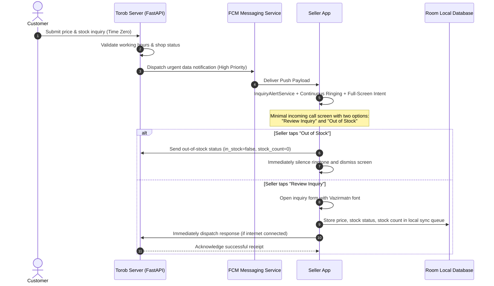

# Comprehensive Web Service & Architecture Documentation: Torob Seller Platform

This document serves as the complete technical reference for all services, data models, authentication processes, inquiry lifecycles, shop status scenarios, and the offline synchronization protocol of the Torob Seller Platform.

---

## 1. System Overview & Architecture

The Torob Instant Inquiry System comprises the following core components:
- **FastAPI Backend**: Implemented with Python 3.12 and SQLite database, providing request queuing, business hours validation, push notification dispatching, and inquiry lifecycle scheduling (`Inquiry Scheduler`).
- **Seller Android App**: Built with Jetpack Compose following a Single Activity architecture + a dedicated full-screen incoming call component (`IncomingInquiryActivity`).
- **Client Local Database (Room Database)**: Local caching for inquiries and an offline synchronization queue featuring an idempotent delivery guarantee (`Infinite Idempotent Queue`).
- **Time-Zero Instant Alert Protocol**: Triggers an incoming call alarm with a dedicated Full-Screen Intent at the exact moment (time zero) a customer registers an inquiry.



---

## 2. Authentication

Seller authentication is based on mobile phone number and one-time password (OTP) with JWT Bearer tokens.

### 2.1. Request OTP
- **Method & Endpoint**: `POST /api/seller/auth/request-otp`
- **Access Level**: Public

#### Request Body
```json
{
  "phone_number": "09123456789"
}
```

#### Successful Response (200 OK)
```json
{
  "success": true,
  "message": "OTP code sent",
  "demo_otp": "12345"
}
```

### 2.2. Verify OTP & Obtain Token
- **Method & Endpoint**: `POST /api/seller/auth/verify-otp`
- **Access Level**: Public

#### Request Body
```json
{
  "phone_number": "09123456789",
  "otp_code": "12345"
}
```

#### Successful Response (200 OK)
```json
{
  "access_token": "eyJhbGciOiJIUzI1NiIsInR5cCI6IkpXVCJ9...",
  "token_type": "bearer",
  "seller": {
    "seller_id": "seller_test_001",
    "phone_number": "09123456789",
    "shop_id": "shop_51d0c1a6edf81ba759726bab",
    "full_name": "Ali Rezaei",
    "is_active": true
  }
}
```

### 2.3. Get Current Seller Profile
- **Method & Endpoint**: `GET /api/seller/auth/me`
- **Access Level**: Requires `Authorization: Bearer <token>` header

---

## 3. Shop Operating Status & Working Hours

A shop can operate under 3 distinct operational scenarios:

| Scenario | `is_open` | `accept_inquiries` | Functional Description |
| :--- | :---: | :---: | :--- |
| **1. Active & Support Available** | `true` | `true` | Shop is open; instant customer inquiries are received, triggering the full-screen incoming call ringtone. |
| **2. Active but Support Disabled** | `true` | `false` | Shop is listed on Torob, but does not receive instant inquiries (ideal during peak in-store hours). |
| **3. Inactive & Closed** | `false` | `false` | Shop is completely closed; no customer inquiries will be routed. |

> [!IMPORTANT]
> **Strict Working Hours Rule**: Outside the shop's defined working hours, the server will never return `is_open=true`, and activation requests will be rejected with an HTTP 400 Bad Request error.

### 3.1. Get Shop Profile & Settings
- **Method & Endpoint**: `GET /api/seller/shop`
- **Successful Response (200 OK)**:
```json
{
  "shop_id": "shop_51d0c1a6edf81ba759726bab",
  "shop_name": "Takht-e Jamshid Mobile",
  "address": "Jomhouri St., Mobile House Passage, Unit 412",
  "phone": "02176557624",
  "is_open": true,
  "open_time": "09:30",
  "close_time": "21:30",
  "accept_inquiries": true,
  "holiday_mode": false,
  "manual_is_open": true,
  "is_within_working_hours": true,
  "status_message": "Shop is open"
}
```

### 3.2. Update Shop Settings / Change Scenario
- **Method & Endpoint**: `PUT /api/seller/shop`
- **Request Body**:
```json
{
  "is_open": true,
  "accept_inquiries": true,
  "open_time": "09:30",
  "close_time": "21:30",
  "holiday_mode": false
}
```

### 3.3. Toggle Shop Status (Quick Open/Close Switch)
- **Method & Endpoint**: `POST /api/seller/shop/toggle-status`

---

## 4. Inquiries & Stock Reporting

### 4.1. List Inquiries
- **Method & Endpoint**: `GET /api/seller/inquiries`
- **Optional Query Parameters**: `status=ACTIVE` | `status=ANSWERED` | `status=EXPIRED`

#### Sample Response (200 OK)
```json
[
  {
    "inquiry_id": "inq_786524",
    "tracking_code": "TRB-98721",
    "shop_id": "shop_51d0c1a6edf81ba759726bab",
    "product_id": "prod_iphone15pro",
    "product_title": "Apple iPhone 15 Pro 256GB Mobile Phone",
    "product_image_url": "https://torob.com/mock/iphone15.jpg",
    "category_name": "Mobiles & Tablets",
    "recorded_price_toman": 68500000,
    "customer_name": "Torob Buyer",
    "customer_phone": "0912***4567",
    "inquiry_type": "price_and_stock",
    "user_note": "Hi, do you have titanium gray color in stock?",
    "status": "ACTIVE",
    "created_at": "2026-10-23 06:15:00",
    "expires_at": "2026-10-23 06:25:00",
    "remaining_seconds": 540
  }
]
```

### 4.2. Submit Inquiry Response with Stock Count
- **Method & Endpoint**: `POST /api/seller/inquiries/{inquiry_id}/respond`

#### Request Body
```json
{
  "client_response_id": "c1f7a0b3-469b-4e89-bcf4-6503c1ef7e6e",
  "offered_price_toman": 68200000,
  "is_in_stock": true,
  "stock_count": 3,
  "notes": "Titanium Gray with 18-month official company warranty",
  "submitted_at": "2026-10-23 06:17:30"
}
```

#### Key Response Fields
- `client_response_id`: Unique client-generated UUID4 for idempotency and duplicate submission prevention (Double Action Prevention).
- `offered_price_toman`: Offered price by the seller in Tomans.
- `is_in_stock`: Stock availability flag (`true` or `false`).
- `stock_count`: **Stock quantity declared by the seller**. Set to `0` if out of stock, and at least `1` if in stock.
- `notes`: Seller's note/comment for the customer.

#### Successful Response (200 OK)
```json
{
  "response_id": "resp_a89bc321fe",
  "client_response_id": "c1f7a0b3-469b-4e89-bcf4-6503c1ef7e6e",
  "inquiry_id": "inq_786524",
  "offered_price_toman": 68200000,
  "is_in_stock": true,
  "stock_count": 3,
  "notes": "Titanium Gray with 18-month official company warranty",
  "submitted_at": "2026-10-23 06:17:30",
  "received_at": "2026-10-23 06:17:31",
  "is_duplicate": false
}
```

---

## 5. Offline Queue & Batch Synchronization

When the seller's device loses internet connectivity:
1. The response is immediately saved to the `sync_queue` table in the local Room database with status `SAVED_ON_PHONE`.
2. The inquiry state in the UI immediately transitions to `ANSWERED`, displaying a "Saved on phone" badge.
3. Upon network reconnection, a batch synchronization (`Batch Sync`) request is automatically dispatched.

### 5.1. Batch Sync Responses
- **Method & Endpoint**: `POST /api/seller/inquiries/batch-sync`

#### Request Body
```json
{
  "items": [
    {
      "inquiry_id": "inq_786524",
      "client_response_id": "c1f7a0b3-469b-4e89-bcf4-6503c1ef7e6e",
      "offered_price_toman": 68200000,
      "is_in_stock": true,
      "stock_count": 2,
      "notes": "Express courier delivery",
      "submitted_at": "2026-10-23 06:17:30"
    }
  ]
}
```

#### Successful Response (200 OK)
```json
{
  "total_processed": 1,
  "synced_count": 1,
  "duplicate_count": 0,
  "results": [
    {
      "response_id": "resp_batch_01",
      "client_response_id": "c1f7a0b3-469b-4e89-bcf4-6503c1ef7e6e",
      "inquiry_id": "inq_786524",
      "offered_price_toman": 68200000,
      "is_in_stock": true,
      "stock_count": 2,
      "notes": "Express courier delivery",
      "submitted_at": "2026-10-23 06:17:30",
      "received_at": "2026-10-23 06:20:00",
      "is_duplicate": false
    }
  ]
}
```

---

## 6. Push Notification & Alert Service

### 6.1. Register Seller FCM Token
- **Method & Endpoint**: `POST /api/seller/push/register-token`

#### Request Body
```json
{
  "fcm_token": "fH92_kS...P9",
  "device_model": "Xiaomi Redmi Note 13",
  "os_version": "Android 14",
  "app_version": "1.0.0",
  "notifications_enabled": true
}
```

### 6.2. Incoming Call Screen Architecture & Conflict Prevention
- The `InquiryAlertService` foreground service triggers the full-screen activity `IncomingInquiryActivity` configured with `setTurnScreenOn(true)` and `setShowWhenLocked(true)`.
- The incoming call interface presents two primary action buttons:
  1. **"Review Inquiry"**: Immediately silences the ringtone and navigates to the inquiry details within the application.
  2. **"Out of Stock"**: Immediately silences the ringtone and submits an out-of-stock response directly without requiring the seller to navigate through the form steps.

---

## 7. Seller Metrics & SLA

### 7.1. Get Seller Performance Metrics & Response Rate
- **Method & Endpoint**: `GET /api/seller/metrics`
- **Successful Response (200 OK)**:
```json
{
  "shop_id": "shop_51d0c1a6edf81ba759726bab",
  "total_inquiries": 42,
  "answered_inquiries": 39,
  "expired_inquiries": 3,
  "active_inquiries": 0,
  "response_rate_percent": 92.8,
  "average_response_time_seconds": 145,
  "average_response_time_formatted": "2 minutes and 25 seconds"
}
```

---

## 8. Common HTTP Error Codes

| HTTP Status Code | Description | Client Action |
| :---: | :--- | :--- |
| **400 Bad Request** | Invalid payload, outside working hours, or inquiry expired | Display error message to user; if expired, move inquiry to history |
| **401 Unauthorized** | Missing or expired authentication token | Navigate user to mobile login screen (`LoginScreen`) |
| **404 Not Found** | Inquiry or shop not found | Verify inquiry / shop ID |
| **500 Server Error** | Internal server error | Push response to client's offline queue for retry |
